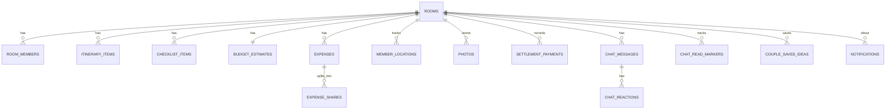

# OTW — Backend Master Plan
**Scope: Backend only (Spring Boot 21 + Supabase Postgres + Redis + Supabase Auth/Realtime)**

> **2026-09-29:** Group/barkada tier removed — see docs/OTW - WEB.pdf's flat Room-only tasking. Backend now has one authorization tier (Room), not two. ~~Anonymous Supabase sessions are rejected; a registered account is required (overrides the PDF's no-login flow).~~
>
> **2026-09-29 (later) — aligned with the product prototype artifact ("From “G tayo?” to “OTW na.”"):** reversed by the project owner. The app is **anonymous-first**: Supabase anonymous sessions are accepted for everything inside a gala; an account is optional and only gates the personal, cross-gala features (My Galas, calendar, history, notifications) via `@RequireAccount` → `401 ACCOUNT_REQUIRED`. Also added: Gala Password + "Enter a Gala" (code + password → "Which one are you?"), gala dates/destination/lifecycle (archive/restore/delete, leave, new code), member permission toggles, travel status, itinerary stop type + reorder, checklist claim, budget categories, expense category + recorded "Mark paid" payments, photo caption, dashboard summary, Chat, Couple Mode, and notification preferences + in-app feed. Design + rationale: `docs/superpowers/specs/2026-09-29-artifact-alignment-design.md`. Migrations V6–V15.
>
> **2026-10-02 — account required everywhere (owner decision):** reverses anonymous-first. Anonymous Supabase sessions are rejected on every route by AccountRequiredFilter (401 ACCOUNT_REQUIRED); login is email + password (OAuth later; Confirm email off); @RequireAccount, AccountRequiredAspect and POST /me/link-account removed; Enter a Gala kept for logged-in users. Spec: docs/superpowers/specs/2026-10-02-real-auth-account-required-design.md.
>
> **2026-10-02 (slice 2A):** `GET /me/rooms` items now include `roomCode`; the frontend My Galas and a new History page read the account-wide list instead of the device registry. Spec: docs/superpowers/specs/2026-10-02-my-galas-history-design.md.
>
> **2026-10-05 — realtime channels made private (implementation drift fix, no spec change):** §8 always specified private, membership-gated `room:{roomId}` channels, but `RealtimeEventPublisher` sent public broadcasts and no `realtime.messages` policy existed. Broadcasts now set `private: true`, and **V16** adds RLS on `realtime.messages`: active room members may receive broadcast/presence on their room's topic and track presence; nobody but the service role can send broadcasts. On a non-Supabase Postgres V16 is a no-op. The frontend (`otw-client/src/lib/otw/live.ts`) subscribes privately and falls back to polling when the channel isn't connected.
>
> **2026-10-05 (later) — gala directory + password on every join (owner decision):** the Join a Gala page now lists galas the Gala Leader opted in with "List this gala" (`rooms.is_listed`, **V17**, default off), via `GET /rooms/directory?q=&cursor=&limit=` (active, listed, not yet ended; soonest first; shows code, title, dates, destination, type, host nickname, member count, full, alreadyMember — no member list). `POST /rooms/join` now **requires** `password` and returns `401 INVALID_GALA_PASSWORD` on a mismatch (a gala with no password can't be joined until the leader sets one). Unlisted galas stay reachable by code only. `PATCH /rooms/{id}` takes `listed`; `RoomDto` returns it.
>
> **2026-10-05 (later still) — directory shows every gala (owner decision, supersedes the opt-in above):** `GET /rooms/directory` now returns **every ACTIVE gala** (archived ones excluded), upcoming/ongoing first by start date, finished ones after. Any logged-in account can see every gala's code, title, dates, destination, type, host nickname and member count, and its member nicknames through `GET /rooms/preview`; the Gala Password on `POST /rooms/join` is the only gate. `rooms.is_listed` (V17) and the `listed` field are kept but **no longer used** (migrations are additive); the "List this gala" switch was removed from the frontend.
>
> **2026-10-05 (latest) — one Drive folder per gala + videos (owner decision):** the backend's Drive access is no longer read-only: the service account (scopes `drive.metadata.readonly` + `drive.file`) creates a folder per gala, "<title> · OTW-XXXX-XXXX", inside `GOOGLE_DRIVE_PHOTOS_FOLDER_ID`, right after Plan a Gala commits (`GalaCreatedEvent` → `GalaFolderOnCreateListener`), or on first upload via `POST /rooms/{id}/photos/folder` (MEMBER + add-photos permission → `{folderId}`; a race keeps the first folder). **V18** adds `rooms.drive_folder_id` and `photos.mime_type`. `POST /rooms/{id}/photos` now requires the file to be inside that gala's folder (the shared folder only for a gala that has none yet) and stores its MIME type; `PhotoDto` returns `mimeType`. The backend still never handles photo or video bytes.
>
> **2026-10-05 (latest, revised) — no Google sign-in for uploaders:** the backend signs in to Drive as the **owner's Google account** (`GOOGLE_DRIVE_OAUTH_CLIENT_ID/_SECRET/_REFRESH_TOKEN`, scope `drive`; files use the owner's storage) or, if those are unset, the service account (works for uploads only in a Shared Drive). `POST /rooms/{id}/photos/uploads {fileName, mimeType image/*|video/*, size ≤ 300 MB}` (MEMBER + add-photos) ensures the gala folder and returns a one-time Drive resumable `uploadUrl` (opened with the browser's allowed `Origin` so Google accepts the browser's PUT); the browser PUTs the bytes straight to Google. `POST /photos` then validates, makes the file viewable by link, and stores it. `POST /photos/folder` was removed.
>
> **2026-10-05 (hardening, no new endpoints):** Drive calls that are safe to repeat (`files.get`, the link permission, opening an upload session, trashing, listing) retry 429/5xx/timeouts up to 3 attempts with backoff (`DriveRetry`). Folder creation is not retried. `POST /photos/uploads` now requires the file name's extension to match its type (photos: jpg, jpeg, png, gif, webp, heic, heif; videos: mp4, mov, webm, m4v, 3gp) or returns `400 INVALID_REQUEST`, and cleans the name (no slashes, control characters or leading dots; 200 characters max). Deleting a photo now also moves its Drive file to the trash after the row's delete commits. `DriveOrphanSweeper` (every 6 h, `GOOGLE_DRIVE_ORPHAN_SWEEP_CRON` / `_MIN_AGE`, default 24 h) trashes files in gala folders that have no `photos` row: uploads never registered, and trash calls that failed. Setup guide: docs/GOOGLE_DRIVE_SETUP.md.
>
> **2026-10-05 (destination pin, owner decision):** **V19** adds `rooms.destination_lat` / `destination_lng` (`DOUBLE PRECISION`, nullable). `POST /rooms` and `PATCH /rooms/{id}` take optional `destinationLat` (−90..90) / `destinationLng` (−180..180), both or neither (else `400`); a `PATCH` that changes `destination` without them clears the old pin. `RoomDto` returns them. They are separate from `meeting_lat/lng` (the meeting place). "Who's OTW?" draws the pin and shows each sharing member's straight-line distance to it, computed in the browser (no new endpoint, nothing stored). Spec: `docs/superpowers/specs/2026-10-05-gala-destination-pin-design.md`.
>
> **2026-10-06 — couple galas hidden from the directory (owner decision, narrows "directory shows every gala"):** `GET /rooms/directory` returns only **GROUP** galas (`room_type <> 'COUPLE'`). A couple gala is reached only with its Gala Code + Gala Password shared by the couple (`GET /rooms/preview?code=` and `POST /rooms/join` are unchanged; the 2-member cap still applies). The couple's own galas stay in My Galas.
>
> **2026-10-07 — deployment + security hardening (owner decision):** production backend moves from **Render to Railway** (frontend stays on Vercel; setup in `docs/DEPLOYMENT.md`). Spring Boot **3.3.4 → 4.1.1** (3.3–3.5 are past OSS support; Jackson 3, Spring Security 7, `spring-boot-starter-flyway`). **V20** revokes all `anon`/`authenticated` privileges on `public` tables, sequences and functions (the browser never reads tables directly; everything goes through the API) and moves the V16 realtime membership check into `otw_private.is_room_channel_member()` (SECURITY DEFINER). Gala Password attempts are also limited **per gala**: 20 wrong passwords in 15 min → `429 TOO_MANY_REQUESTS` for that gala (`GalaPasswordGuard`). Swagger/OpenAPI off unless `API_DOCS_ENABLED=true`; rate limiting no longer trusts a raw `X-Forwarded-For` (`server.forward-headers-strategy=native`); unknown URLs → 404, wrong method → 405 (were 500). Frontend CSP is per request with a script nonce (`otw-client/src/proxy.ts`).
>
> **2026-10-07 (later) — chat photos + reaction picker (owner decision):** a chat message can carry a photo: the browser uploads it through the Gala Dump flow (`POST /photos/uploads` → Drive → `POST /photos`), so it **is** a Gala Dump photo, then sends `POST /chat/messages {body, photoId}`. The photo must be the caller's own, `READY`, in the same gala, or `400 INVALID_PHOTO_REFERENCE`; `body` becomes an optional caption (still required without a photo, `400 INVALID_REQUEST`). Stored as a TEXT message with `ref_type = 'PHOTO'`, `ref_id = photoId` (no schema change); `ChatMessageDto.photo {driveFileId, mimeType}` is null when the photo was deleted from the Dump. Reactions: **V21** adds `chat_reactions.reaction` (`HEART|HAHA|WOW|SAD|ANGRY|LIKE`, default `HEART`); still one per member per message, a new pick replaces the old. `PUT /chat/messages/{id}/reaction {reaction}` / `DELETE …/reaction`; the `/heart` endpoints stay as aliases. `ChatMessageDto` adds `reactions` (count per type) and `myReaction`; `heartCount`/`reactedByMe` now mean hearts only. `chat.reaction.changed` adds `reaction` (null when removed) and `reactions`. The frontend's quick-reply chips were removed.

This guide takes the OTW Master Project Management Plan and narrows it to everything the backend team needs, from an empty repo to a production-ready API. Frontend/UI/branding work is intentionally out of scope here.

---

## 0. Backend Guiding Rules

1. Postgres (Supabase) is the source of truth. Redis is disposable — the API must degrade gracefully (slower, not broken) if Redis is down.
2. Every endpoint that touches a room must check **room membership + role**, even if the JWT is valid. Valid identity ≠ valid access.
3. Money math uses `BigDecimal` with a fixed scale (2 decimals) and `RoundingMode.HALF_UP` — never `double`/`float`.
4. No endpoint returns an unbounded collection — everything paginated.
5. Every mutation that other room members should see emits a realtime event. Realtime is a *broadcast of a change*, not a replacement for querying the DB.
6. Don't build microservices. One Spring Boot modular monolith, package-by-feature.

---

## 1. Backend Project Structure

```
otw-backend/
├── src/main/java/com/otw/
│   ├── OtwApplication.java
│   ├── config/              # SecurityConfig, RedisConfig, CacheConfig, CorsConfig, WebSocketConfig, RateLimitConfig
│   ├── common/               # BaseException, ApiResponse, ErrorCode, AuditFields, PageResponse
│   ├── security/
│   │   ├── jwt/               # Supabase JWT filter + JWK verification (anonymous sessions rejected by AccountRequiredFilter)
│   │   ├── authz/              # @RequireRoomRole + RoomAccessAspect
│   │   ├── AccountRequiredFilter.java   # global account gate, lives directly in security/ (not authz/)
│   ├── room/
│   │   ├── controller/
│   │   ├── dto/
│   │   ├── entity/
│   │   ├── repository/
│   │   └── service/
│   ├── rsvp/
│   │   ├── controller/
│   │   ├── dto/
│   │   ├── entity/
│   │   ├── repository/
│   │   └── service/
│   ├── itinerary/
│   │   ├── controller/
│   │   ├── dto/
│   │   ├── entity/
│   │   ├── repository/
│   │   └── service/
│   ├── checklist/
│   │   ├── controller/
│   │   ├── dto/
│   │   ├── entity/
│   │   ├── repository/
│   │   └── service/
│   ├── budget/
│   │   ├── controller/
│   │   ├── dto/
│   │   ├── entity/
│   │   ├── repository/
│   │   └── service/
│   ├── expense/
│   │   ├── controller/
│   │   ├── dto/
│   │   ├── entity/
│   │   ├── repository/
│   │   └── service/
│   ├── location/
│   │   ├── controller/
│   │   ├── dto/
│   │   ├── entity/
│   │   ├── repository/
│   │   └── service/
│   ├── photo/
│   │   ├── controller/
│   │   ├── dto/
│   │   ├── entity/
│   │   ├── repository/
│   │   └── service/
│   ├── chat/                    # Chismis: messages (+ Gala Dump photos), reactions, read markers, system/card lines (same five folders)
│   ├── couple/                  # Couple Mode saved date ideas (same five folders)
│   ├── notification/            # preferences, in-app feed, after-commit fan-out, reminder scheduler (same five folders)
│   ├── realtime/                # RealtimeEventPublisher (Supabase Broadcast client) — cross-cutting, no controller
│   ├── cache/                   # CacheKeys, CacheEvictionService — cross-cutting, no controller
│   └── ratelimit/                # cross-cutting, no controller
├── src/main/resources/
│   ├── application.yml
│   ├── application-local.yml
│   ├── application-prod.yml
│   └── db/migration/            # Flyway: V1__init.sql, V2__..., etc.
└── src/test/java/com/otw/       # mirrors main packages
```

Every feature package (`room`, `rsvp`, `itinerary`, `checklist`, `budget`, `expense`, `location`, `photo`, `chat`, `couple`, `notification`) follows the same five-folder shape (RSVP lives in `room` — there is no separate `rsvp` package in code):

- **`controller/`** — REST endpoints only. No business logic, no direct repository calls — delegates to `service/`.
- **`dto/`** — request/response objects (e.g. `CreateRoomRequest`, `RoomSummaryDto`). Controllers bind to these, never to entities directly (prevents mass assignment — §9).
- **`entity/`** — JPA entities mapped to the tables in §3 (e.g. `Room`, `RoomMember`).
- **`repository/`** — Spring Data JPA repositories, one per entity.
- **`service/`** — business logic, transaction boundaries (`@Transactional`), authorization-adjacent logic that isn't already covered by the `@RequireRoomRole` aspect, and where realtime events / cache evictions get triggered after a write.

`realtime/`, `cache/`, and `ratelimit/` stay cross-cutting (no five-folder split) since they're shared infrastructure every feature calls into, not a feature with its own endpoints.

---

## 2. Backend Roadmap (mapped to WBS in the master doc)

| Phase | Backend Deliverable | Maps to |
|---|---|---|
| Phase 3 — Technical Planning | ERD, API contract, auth model, cache/realtime architecture (this doc) | WBS 4–9 |
| Phase 4 — Foundation | Repo, Spring Boot skeleton, Flyway baseline, Supabase project, Redis, CI | WBS 4 |
| Phase 5 — Core MVP | Room → Members → RSVP → Itinerary → Checklist → Budget → Expenses | Sprints 2–4 |
| Phase 6 — Realtime + Performance | Realtime publisher, Redis caching, rate limiting, indexing | Sprint 5 |
| Phase 7 — Fun Layer | Location sharing, wheel/decision endpoints (thin, stateless) | Sprint 5 |
| Phase 8 — QA + Security | Test suite, threat mitigations, load test | Sprint 6 |

---

## 3. Database Design

### 3.1 Core tables

Flat model: every **Room** (one-off gala/trip) is standalone. There is no persistent group/barkada tier — `room_members` is the only membership table (Group/barkada tier removed 2026-09-29, see docs/OTW - WEB.pdf's flat Room-only model).

```sql
-- rooms — one gala/trip, always standalone
rooms (
  id UUID PK DEFAULT gen_random_uuid(),
  room_code VARCHAR(8) UNIQUE NOT NULL,   -- short, human-shareable, indexed
  title VARCHAR(120) NOT NULL,
  schedule_at TIMESTAMPTZ,
  meeting_lat DOUBLE PRECISION,
  meeting_lng DOUBLE PRECISION,
  meeting_label VARCHAR(255),
  host_user_id UUID NOT NULL,
  status VARCHAR(20) NOT NULL DEFAULT 'ACTIVE', -- ACTIVE, ARCHIVED
  created_at TIMESTAMPTZ NOT NULL DEFAULT now(),
  updated_at TIMESTAMPTZ NOT NULL DEFAULT now()
);

-- room_members
room_members (
  id UUID PK DEFAULT gen_random_uuid(),
  room_id UUID NOT NULL REFERENCES rooms(id) ON DELETE CASCADE,
  user_id UUID NOT NULL,               -- Supabase auth.users.id
  nickname VARCHAR(60) NOT NULL,
  role VARCHAR(20) NOT NULL DEFAULT 'MEMBER',  -- HOST, MEMBER
  rsvp_status VARCHAR(20) NOT NULL DEFAULT 'PENDING', -- GOING, MAYBE, NOT_GOING, PENDING
  joined_at TIMESTAMPTZ NOT NULL DEFAULT now(),
  left_at TIMESTAMPTZ,
  UNIQUE (room_id, user_id)
);
-- Partial unique index (added V5): nickname unique per room, case-insensitive, active members only
-- CREATE UNIQUE INDEX idx_room_members_room_nickname_active ON room_members (room_id, LOWER(nickname)) WHERE left_at IS NULL;

-- itinerary_items
itinerary_items (
  id UUID PK DEFAULT gen_random_uuid(),
  room_id UUID NOT NULL REFERENCES rooms(id) ON DELETE CASCADE,
  title VARCHAR(150) NOT NULL,
  notes TEXT,
  starts_at TIMESTAMPTZ,
  position INT NOT NULL,               -- for manual ordering
  created_by UUID NOT NULL,
  completed BOOLEAN NOT NULL DEFAULT false,
  version INT NOT NULL DEFAULT 0,      -- optimistic locking
  created_at TIMESTAMPTZ NOT NULL DEFAULT now(),
  updated_at TIMESTAMPTZ NOT NULL DEFAULT now()
);

-- checklist_items
checklist_items (
  id UUID PK DEFAULT gen_random_uuid(),
  room_id UUID NOT NULL REFERENCES rooms(id) ON DELETE CASCADE,
  label VARCHAR(150) NOT NULL,
  assigned_to UUID,                    -- nullable → unassigned
  is_done BOOLEAN NOT NULL DEFAULT false,
  done_by UUID,
  done_at TIMESTAMPTZ,
  version INT NOT NULL DEFAULT 0,
  created_at TIMESTAMPTZ NOT NULL DEFAULT now()
);

-- budget_estimates
budget_estimates (
  room_id UUID PRIMARY KEY REFERENCES rooms(id) ON DELETE CASCADE,
  estimated_amount NUMERIC(12,2) NOT NULL DEFAULT 0,
  currency VARCHAR(3) NOT NULL DEFAULT 'PHP',
  updated_by UUID,
  updated_at TIMESTAMPTZ NOT NULL DEFAULT now()
);

-- expenses
expenses (
  id UUID PK DEFAULT gen_random_uuid(),
  room_id UUID NOT NULL REFERENCES rooms(id) ON DELETE CASCADE,
  description VARCHAR(150) NOT NULL,
  amount NUMERIC(12,2) NOT NULL CHECK (amount > 0),
  paid_by UUID NOT NULL,               -- room_members.user_id
  created_at TIMESTAMPTZ NOT NULL DEFAULT now()
);

-- expense_shares
expense_shares (
  id UUID PK DEFAULT gen_random_uuid(),
  expense_id UUID NOT NULL REFERENCES expenses(id) ON DELETE CASCADE,
  user_id UUID NOT NULL,
  share_amount NUMERIC(12,2) NOT NULL CHECK (share_amount >= 0),
  UNIQUE (expense_id, user_id)
);

-- locations (live/pin sharing — ephemeral, see §7)
member_locations (
  room_id UUID NOT NULL REFERENCES rooms(id) ON DELETE CASCADE,
  user_id UUID NOT NULL,
  lat DOUBLE PRECISION NOT NULL,
  lng DOUBLE PRECISION NOT NULL,
  share_mode VARCHAR(10) NOT NULL,     -- PIN, LIVE
  expires_at TIMESTAMPTZ NOT NULL,     -- LIVE shares auto-expire
  updated_at TIMESTAMPTZ NOT NULL DEFAULT now(),
  PRIMARY KEY (room_id, user_id)
);

-- photos (metadata only; binary lives in Google Drive)
photos (
  id UUID PK DEFAULT gen_random_uuid(),
  room_id UUID NOT NULL REFERENCES rooms(id) ON DELETE CASCADE,
  drive_file_id VARCHAR(200) NOT NULL,
  uploaded_by UUID NOT NULL,
  status VARCHAR(20) NOT NULL DEFAULT 'PENDING', -- PENDING, READY, FAILED
  created_at TIMESTAMPTZ NOT NULL DEFAULT now()
);
```

#### 3.1.1 Added by V6–V15 (artifact alignment, 2026-09-29)

```sql
-- V6 rooms: gala details + Gala Password (schedule_at kept, written as start date+time)
rooms += destination VARCHAR(150), start_date DATE, end_date DATE, start_time TIME, end_time TIME,
         password_hash VARCHAR(100)          -- BCrypt; NULL for pre-V6 rooms (Enter a Gala unavailable until set)
         CHECK (end_date >= start_date)
-- V7 rooms: Couple Mode + "What members can do"
rooms += room_type VARCHAR(10) DEFAULT 'GROUP' CHECK IN ('GROUP','COUPLE'),
         members_can_edit_plan, members_can_add_photos, members_can_delete_own_photos,
         location_sharing_enabled  BOOLEAN DEFAULT true;  status CHECK IN ('ACTIVE','ARCHIVED')
-- V8 room_members
room_members += has_account BOOLEAN DEFAULT false,   -- backfilled true (pre-V8 members were all accounts)
                travel_status VARCHAR(20) DEFAULT 'STILL_HOME'  -- STILL_HOME, ON_THE_WAY, ALMOST_THERE, ARRIVED
-- V9 itinerary_items += stop_type VARCHAR(20) DEFAULT 'ACTIVITY'   -- MEET_UP, ACTIVITY, FOOD
-- V10 budget_estimates += transport/stay/food/activities/other_amount NUMERIC(12,2) DEFAULT 0,
--                         participant_count INT DEFAULT 1   (estimated_amount = sum, written by the service)
-- V11 expenses += category VARCHAR(20) DEFAULT 'OTHER', note VARCHAR(255)
settlement_payments (id, room_id FK CASCADE, from_user_id, to_user_id, amount NUMERIC(12,2) > 0,
                     recorded_by, created_at, CHECK from <> to)
-- V12 photos += caption VARCHAR(140)
-- V13 chat
chat_messages (id, room_id FK CASCADE, sender_user_id NULL, kind TEXT|SYSTEM|CARD, body VARCHAR(1000),
               ref_type, ref_id, created_at)
chat_reactions (message_id FK CASCADE, user_id, created_at, PK(message_id, user_id))   -- one per member (V21: + reaction)
chat_read_markers (room_id FK CASCADE, user_id, last_read_at, PK(room_id, user_id))
-- V14 couple_saved_ideas (room_id FK CASCADE, idea_key, saved_by, created_at, PK(room_id, idea_key))
-- V15 notification_preferences (user_id PK, 7 BOOLEAN toggles, updated_at)
notifications (id, user_id, room_id FK CASCADE NULL, type, title, body, dedupe_key, created_at, read_at,
               UNIQUE(user_id, dedupe_key))
-- V16 RLS on realtime.messages (Supabase only; no-op elsewhere): SELECT broadcast/presence and
--     INSERT presence for active members whose room matches realtime.topic() = 'room:{roomId}'
-- V17 rooms += is_listed BOOLEAN NOT NULL DEFAULT false; partial index (start_date) WHERE is_listed AND status='ACTIVE'
-- V19 rooms += destination_lat, destination_lng DOUBLE PRECISION (nullable; the destination's map pin, both or neither)
-- V20 revoke anon/authenticated on public tables/sequences/functions; otw_private.is_room_channel_member()
-- V21 chat_reactions += reaction VARCHAR(10) NOT NULL DEFAULT 'HEART' CHECK IN (HEART, HAHA, WOW, SAD, ANGRY, LIKE)
```
Every new table has an RLS SELECT policy (members of the room, or `user_id = auth.uid()` for per-user tables). Every column holding a user id inside a room must also be listed in `MemberIdentityRemapper` (see §5.1 "Enter a Gala").

### 3.2 Indexes (minimum set)
- `rooms(room_code)` — unique, used on every "join" call
- `rooms(status, start_date)` — My Galas buckets + reminder scheduler
- `chat_messages(room_id, created_at DESC, id DESC)`, `notifications(user_id, created_at DESC, id DESC)`, `settlement_payments(room_id, created_at DESC)`, `photos(room_id, created_at DESC)`
- `room_members(room_id, user_id)` — unique composite, used on every authorization check
- `room_members(room_id, LOWER(nickname)) WHERE left_at IS NULL` — unique partial index, enforces per-room nickname uniqueness among active members
- `room_members(user_id)` — "my rooms" queries
- `itinerary_items(room_id, position)`
- `checklist_items(room_id, is_done)`
- `expenses(room_id)`, `expense_shares(expense_id)`
- `member_locations(room_id)` with a background job / `expires_at` cleanup

### 3.3 Concurrency fields
- `version` (optimistic locking via `@Version` in JPA) on itinerary and checklist items — this is what answers "two people edit the same item at once": last-write loses with a `409 CONFLICT`, client refetches.
- Expense creation has no shared mutable row to race on (each expense is its own insert) — no locking needed there, only on the *settlement calculation*, which should always be computed on read, never stored as a mutable running total.

### 3.4 Flyway
Since Flyway is already the chosen tool: keep migrations additive and reversible in spirit (no `DROP COLUMN` in early sprints), one feature per migration file (`V3__add_checklist_items.sql`), and never edit a migration that has already run in a shared environment — add a new one instead.

### 3.5 ERD (Mermaid)


---

## 4. API Contract (`/api/v1`)

Conventions: JSON, `Authorization: Bearer <supabase_jwt>` on every call — a registered (non-anonymous) account is required on every endpoint (§5.1), cursor-based pagination (`?cursor=...&limit=20`), errors as `{ "code": "ROOM_NOT_FOUND", "message": "..." }`.

| Method | Path | Purpose | Role |
|---|---|---|---|
| POST | `/rooms` | Create standalone room | Authenticated |
| GET | `/rooms/{roomId}` | Room overview | Member |
| POST | `/rooms/join` | Join by room code + Gala Password (+ nickname) | Authenticated, rate-limited |
| GET | `/rooms/directory?q=&cursor=&limit=` | Every active gala for the Join a Gala page (paginated, max 50) | Authenticated |
| GET | `/rooms/{roomId}/members` | Member list | Member |
| DELETE | `/rooms/{roomId}/members/{userId}` | Remove member | Host |
| PATCH | `/rooms/{roomId}/members/me/rsvp` | Update own RSVP | Member |
| GET | `/rooms/{roomId}/itinerary` | List items | Member |
| POST | `/rooms/{roomId}/itinerary` | Add item | Member |
| PATCH | `/rooms/{roomId}/itinerary/{itemId}` | Edit item (needs `version`) | Member (owner or host) |
| DELETE | `/rooms/{roomId}/itinerary/{itemId}` | Remove item | Member (owner or host) |
| GET | `/rooms/{roomId}/checklist` | List items | Member |
| POST | `/rooms/{roomId}/checklist` | Add item | Member |
| PATCH | `/rooms/{roomId}/checklist/{itemId}` | Toggle/assign (needs `version`) | Member |
| GET/PUT | `/rooms/{roomId}/budget` | Get/set estimate | Member / Host |
| GET | `/rooms/{roomId}/expenses` | List, paginated | Member |
| POST | `/rooms/{roomId}/expenses` | Add expense + shares | Member |
| GET | `/rooms/{roomId}/expenses/settlement` | Computed "who owes who" | Member |
| PUT | `/rooms/{roomId}/location` | Share pin or start live share | Member (opt-in) |
| DELETE | `/rooms/{roomId}/location` | Stop sharing | Member |
| GET | `/rooms/{roomId}/locations` | Current shared locations | Member |
| POST | `/rooms/{roomId}/photos/uploads` | One-time Drive upload URL in the gala's folder (photo/video, ≤ 300 MB, allowed extension) | Member |
| POST | `/rooms/{roomId}/photos` | Register uploaded photo metadata | Member |
| DELETE | `/rooms/{roomId}/photos/{photoId}` | Delete photo row; its Drive file is trashed after commit | Member (host any; own while toggle on) |

**Added 2026-09-29 (artifact alignment).** "HOST ✱" / "Member ✱" = also allowed on an archived gala (`allowArchived`); every other non-GET room endpoint returns `409 ROOM_ARCHIVED` on an archived gala.

| Method | Path | Purpose | Role |
|---|---|---|---|
| GET | `/rooms/preview?code=` | "Is this the one?" preview (title, dates, destination, type, member count, ≤12 nicknames, full) | Authenticated, rate-limited |
| POST | `/rooms/enter` | Enter a Gala: `{roomCode, password}` → members for "Which one are you?" | Authenticated, rate-limited |
| POST | `/rooms/enter/claim` | `{roomCode, password, memberId}` → rebind that unclaimed member to the caller | Authenticated, rate-limited |
| GET | `/rooms/{roomId}/summary` | Dashboard cards + recap counts | Member |
| PATCH | `/rooms/{roomId}` | Edit gala details (incl. destination pin `destinationLat/Lng`) + member permission toggles | Host |
| PUT | `/rooms/{roomId}/password` | Change Gala Password | Host |
| POST | `/rooms/{roomId}/code` | Make a new gala code | Host |
| POST | `/rooms/{roomId}/archive` · `/restore` | Shelve to "Mga Drawing" · revive | Host · Host ✱ |
| DELETE | `/rooms/{roomId}` | Delete gala (cascade) | Host ✱ |
| POST | `/rooms/{roomId}/members/{userId}/nudge` | Nudge a Maybe | Host |
| PATCH | `/rooms/{roomId}/members/me` | Change own nickname | Member |
| PUT | `/rooms/{roomId}/members/me/travel-status` | STILL_HOME / ON_THE_WAY / ALMOST_THERE / ARRIVED | Member |
| POST | `/rooms/{roomId}/members/me/leave` | Leave gala (host → `409 HOST_CANNOT_LEAVE`) | Member ✱ |
| POST | `/rooms/{roomId}/itinerary/reorder` | Full ordered list with versions | Member (edit-plan permission) |
| POST | `/rooms/{roomId}/checklist/{itemId}/claim` | Assign to me (needs `version`) | Member |
| GET | `/rooms/{roomId}/checklist?mine=true` / `/photos?mine=true` | "Mine" filters | Member |
| POST | `/rooms/{roomId}/expenses/settlement/payments` | "Mark paid" (from/to/host only; ≤ outstanding) | Member |
| DELETE | `/rooms/{roomId}/expenses/settlement/payments/{paymentId}` | Undo (recorder or host) | Member |
| GET / POST | `/rooms/{roomId}/chat/messages` | Newest-first page · send `{body, photoId?}` (20/min/member; photoId = caller's own Gala Dump photo) | Member |
| PUT / DELETE | `/rooms/{roomId}/chat/messages/{messageId}/reaction` | Set `{reaction}` (replaces mine) / remove | Member |
| PUT / DELETE | `/rooms/{roomId}/chat/messages/{messageId}/heart` | Alias: HEART on / my reaction off | Member |
| PUT | `/rooms/{roomId}/chat/read` · GET `/chat/unread` | Mark read · unread count + first unread id | Member ✱ · Member |
| GET | `/rooms/{roomId}/couple/ideas` | Date idea catalog + saved flags (couple galas only) | Member |
| PUT / DELETE | `/rooms/{roomId}/couple/ideas/{key}` | Save / unsave an idea | Member |
| GET | `/me/rooms?view=upcoming\|ongoing\|completed\|archived` or `?from=&to=` | My Galas / calendar (≤62-day range) · each item carries `roomCode` (8 chars, no `OTW-` prefix) so any device can route to `/gala/OTW-XXXX-XXXX` | Account |
| GET | `/me/rooms/stats` | Gala History tiles | Account |
| GET / PUT | `/me/notification-preferences` | Seven reminder toggles | Account |
| GET | `/me/notifications` · `/me/notifications/unread-count` | Feed (cursor) · bell badge | Account |
| PATCH / POST | `/me/notifications/{id}/read` · `/me/notifications/read-all` | Mark read | Account |

Changed existing endpoints: `POST /rooms` now takes `startDate` (required), `endDate`, `startTime`, `endTime`, `destination`, `password` (6–72), `type` (GROUP/COUPLE); `POST /rooms/join` accepts codes typed with an `OTW-` prefix/dashes, reactivates a member who left, and enforces the 2-person couple cap; `PUT /budget` takes the five categories + `participantCount` and is open to members while "Edit the plan" is on; `POST /expenses` takes optional `paidBy`, `category`, `note` and defaults the split to members who are GOING; `GET /expenses/settlement` now includes recorded `payments`, the caller's `me` totals and `settled`.

Every write endpoint: Bean Validation on the request DTO, ownership/role check via the `@RequireRoomRole` aspect (see §5.3), and — where relevant — emits a realtime event (§8) and evicts a cache key (§6).

Error codes added since the original contract: `409 DUPLICATE_NICKNAME` on `POST /rooms/join` (nickname already taken by an active member of that room); `401 ACCOUNT_REQUIRED` on any endpoint for anonymous or email-less tokens (distinct from the generic `401 UNAUTHENTICATED` — see §5.1); `401 INVALID_GALA_PASSWORD`; `403 PERMISSION_DISABLED`; `404 NOT_A_COUPLE_ROOM`, `PAYMENT_NOT_FOUND`, `CHAT_MESSAGE_NOT_FOUND`, `NOTIFICATION_NOT_FOUND`; `409 ROOM_ARCHIVED`, `ROOM_FULL`, `MEMBER_HAS_ACCOUNT`, `HOST_CANNOT_LEAVE`, `ALREADY_CLAIMED`, `SETTLEMENT_MISMATCH`.

---

## 5. Authentication & Authorization

### 5.1 Authentication (who are you)
- Supabase Auth issues JWTs (email + password; anonymous sessions are rejected, see below).
- Spring Boot does **not** re-implement login, signup, or token refresh — the frontend talks to Supabase Auth directly and just attaches the resulting token as `Authorization: Bearer <token>`. The backend's only job is to **verify** that token on every request.
- Reject any token whose `aud`/`iss` doesn't match your Supabase project.
- **Account required everywhere (2026-10-02, owner decision; reverses the 2026-09-29 anonymous-first rule).** Supabase anonymous sessions are **rejected**: `AccountRequiredFilter` returns `401 {"code":"ACCOUNT_REQUIRED"}` for any token that is anonymous (`is_anonymous`) or has no `email` claim (fail-closed), on every route except the public/health/docs paths. There is no per-endpoint annotation; new endpoints are protected by default. The frontend routes to `/login?next=...`. Supabase "Allow anonymous sign-ins" must stay OFF; login is email + password (OAuth providers planned; Confirm email off).
- **Enter a Gala** (logged-in users only): `POST /rooms/enter` checks the Gala Code + Gala Password (BCrypt) and lists members; `POST /rooms/enter/claim` rebinds the picked unclaimed member row (legacy anonymous rows or members added before an account existed) to the caller and `MemberIdentityRemapper` moves every room-scoped user-id column (items, shares, payments, photos, chat, …) in the same transaction. Members with `has_account = true` can't be claimed (`409 MEMBER_HAS_ACCOUNT`). Both steps are rate-limited per client. Wrong code → `404 INVALID_CODE`; wrong password → `401 INVALID_GALA_PASSWORD`.

#### 5.1.1 Implementation — verifying Supabase JWTs in Spring Boot

Use Spring Security's built-in **OAuth2 Resource Server** support rather than hand-rolling JWKS fetching/caching — it already handles key rotation, caching, and signature verification correctly.

**Dependencies (`build.gradle`):**
```groovy
implementation 'org.springframework.boot:spring-boot-starter-oauth2-resource-server'
implementation 'org.springframework.boot:spring-boot-starter-security'
```

**`application.yml`:**
```yaml
supabase:
  project-url: ${SUPABASE_URL}          # e.g. https://xxxx.supabase.co
  jwt-audience: ${SUPABASE_JWT_AUD:authenticated}

spring:
  security:
    oauth2:
      resourceserver:
        jwt:
          jwk-set-uri: ${SUPABASE_URL}/auth/v1/.well-known/jwks.json
          issuer-uri: ${SUPABASE_URL}/auth/v1
```
`jwk-set-uri` is what gives you automatic key fetch + cache + rotation for free — Spring re-fetches keys on a cache-miss (e.g. unknown `kid` after Supabase rotates keys) rather than you writing that logic yourself.

**`SecurityConfig.java`:**
```java
@Configuration
@EnableWebSecurity
@EnableMethodSecurity
public class SecurityConfig {

    @Value("${supabase.jwt-audience}")
    private String expectedAudience;

    @Bean
    public SecurityFilterChain filterChain(HttpSecurity http) throws Exception {
        http
            .csrf(AbstractHttpConfigurer::disable)   // stateless bearer-token API
            .sessionManagement(sm -> sm.sessionCreationPolicy(SessionCreationPolicy.STATELESS))
            .authorizeHttpRequests(auth -> auth
                .requestMatchers("/actuator/health").permitAll()
                .anyRequest().authenticated()
            )
            .oauth2ResourceServer(oauth2 -> oauth2
                .jwt(jwt -> jwt.jwtAuthenticationConverter(supabaseJwtConverter()))
            )
            .exceptionHandling(ex -> ex
                .authenticationEntryPoint((req, res, e) -> {
                    res.setStatus(HttpServletResponse.SC_UNAUTHORIZED);
                    res.setContentType("application/json");
                    res.getWriter().write("{\"code\":\"UNAUTHENTICATED\",\"message\":\"Invalid or missing token\"}");
                })
                .accessDeniedHandler((req, res, e) -> {
                    res.setStatus(HttpServletResponse.SC_FORBIDDEN);
                    res.setContentType("application/json");
                    res.getWriter().write("{\"code\":\"FORBIDDEN\",\"message\":\"Not allowed\"}");
                })
            );
        return http.build();
    }

    // Explicit audience + issuer validation on top of the default signature/expiry checks
    @Bean
    public JwtDecoder jwtDecoder(@Value("${spring.security.oauth2.resourceserver.jwt.jwk-set-uri}") String jwkSetUri,
                                  @Value("${spring.security.oauth2.resourceserver.jwt.issuer-uri}") String issuerUri) {
        NimbusJwtDecoder decoder = NimbusJwtDecoder.withJwkSetUri(jwkSetUri).build();

        OAuth2TokenValidator<Jwt> withIssuer = JwtValidators.createDefaultWithIssuer(issuerUri); // exp, iat, issuer
        OAuth2TokenValidator<Jwt> withAudience = jwt ->
            jwt.getAudience().contains(expectedAudience)
                ? OAuth2TokenValidatorResult.success()
                : OAuth2TokenValidatorResult.failure(new OAuth2Error("invalid_audience", "aud mismatch", null));

        decoder.setJwtValidator(new DelegatingOAuth2TokenValidator<>(withIssuer, withAudience));
        return decoder;
    }

    // Maps the Supabase JWT's "sub" claim (and role claim, if you add one) into Spring's Authentication
    @Bean
    public Converter<Jwt, AbstractAuthenticationToken> supabaseJwtConverter() {
        return jwt -> {
            String userId = jwt.getSubject(); // Supabase auth.users.id
            List<GrantedAuthority> authorities = List.of(new SimpleGrantedAuthority("ROLE_USER"));
            return new JwtAuthenticationToken(jwt, authorities, userId);
        };
    }
}
```

**Reading the current user in a controller/service** — avoid pulling `SecurityContextHolder` everywhere; wrap it once:
```java
@Component
public class CurrentUserProvider {
    public UUID getUserId() {
        Authentication auth = SecurityContextHolder.getContext().getAuthentication();
        if (auth == null || !auth.isAuthenticated()) {
            throw new UnauthenticatedException();
        }
        return UUID.fromString(auth.getName()); // "name" = the sub we set above
    }
}
```

**What this gives you automatically:** signature verification against Supabase's live JWKS, expiry (`exp`) and issued-at checks, key rotation handling, and now explicit `aud` checking on top. **What it does NOT do:** room membership/role checks — that's still the separate `@RequireRoomRole` authorization layer in §5.2, which runs *after* this filter, using the `userId` this filter puts in the security context.

### 5.2 Authorization (are you allowed here) — one tier

There is a single membership check: room membership. There is no group tier to conflate it with.

Layered checks, cheapest first, for a **room**-scoped endpoint:
1. **JWT valid?** → filter, rejects before hitting a controller.
2. **Room exists?** → 404 if not (don't leak "exists but you can't see it" vs "doesn't exist" — same 404 for both to avoid room-code enumeration hints).
3. **Is this user a member of this room?** → `room_members` lookup, cached (see §6). 403 if not.
4. **Does this action require HOST?** → role check.

Implement as a method-level guard, not scattered in controllers:

```java
@RequireRoomRole(RoomRole.MEMBER)
@PatchMapping("/rooms/{roomId}/checklist/{itemId}")
public ChecklistItemDto toggle(@PathVariable UUID roomId, ...) { ... }
```
One AOP aspect (`RoomAccessGuard`) reads the `roomId` path variable, looks up membership cache-first, and throws `403` before the method body runs.

This layered guard is the single most important control against "guessing/manipulating URLs" (Objective O5) — never trust a `roomId` in the path or body without the matching check, on every endpoint, no exceptions.

### 5.3 Role matrix (starting point — refine per feature)

**Room level**

| Action | HOST | MEMBER | Unauthenticated |
|---|---|---|---|
| Create room | ✅ (becomes host) | ✅ | ❌ |
| Join room | ✅ | ✅ | ❌ |
| Edit room details, permissions, password, code; archive/restore/delete | ✅ | ❌ | ❌ |
| Remove member, nudge a Maybe | ✅ | ❌ | ❌ |
| RSVP, nickname, travel status (own) | ✅ | ✅ | ❌ |
| Leave gala | ❌ (archive/delete instead) | ✅ | ❌ |
| Itinerary/checklist add | ✅ | ✅ while "Edit the plan" is on | ❌ |
| Itinerary/checklist edit/delete | ✅ | owner only, while "Edit the plan" is on | ❌ |
| Itinerary reorder (room-level) | ✅ | ✅ while "Edit the plan" is on | ❌ |
| Checklist tick done/undone, claim | ✅ | ✅ | ❌ |
| Set budget estimate | ✅ | ✅ while "Edit the plan" is on | ❌ |
| Add expense | ✅ | ✅ | ❌ |
| Delete expense | ✅ | payer only | ❌ |
| Mark paid / undo | ✅ | the two people involved / whoever recorded it | ❌ |
| Add photo | ✅ | ✅ while "Add photos" is on | ❌ |
| Delete photo | ✅ any | own only, while "Delete only their own photos" is on | ❌ |
| Share location | ✅ | ✅ (opt-in) while "Share live location" is on; closes 3 h after the gala ends | ❌ |
| Chat, reactions, couple ideas | ✅ | ✅ | ❌ |
| View another room's data | ❌ | ❌ | ❌ |

"Unauthenticated" means no valid token at all; an anonymous Supabase session is rejected with 401 ACCOUNT_REQUIRED. Member permission toggles never restrict the host.

### 5.4 Row-Level Security as a second layer
Even though Spring Boot enforces authorization, if the mobile team ever queries Supabase directly (e.g. Realtime subscription payloads, or a future direct-to-Supabase read), **RLS policies on every table must independently enforce room membership**. Defense in depth: don't rely on the API being the only door.

> **Caveat (2026-10-02):** the API gate (`AccountRequiredFilter`) is global, but RLS read policies do not check `is_anonymous`. Legacy anonymous members whose Supabase sessions are still valid could therefore read their own rooms directly via PostgREST/Realtime. Turning the dashboard "Allow anonymous sign-ins" toggle OFF only stops NEW anonymous sign-ins; it does not revoke existing sessions. Direct Supabase access depends on RLS plus that dashboard setting.

---

## 6. Caching Strategy (Redis)

| Data | Cache? | Key | TTL | Invalidate on |
|---|---|---|---|---|
| Room membership check | Yes | `room:{roomId}:member:{userId}` | 5 min | member added/removed |
| Room overview | Yes | `room:{roomId}:overview` | 60 s | any room-level edit |
| Itinerary list | Yes | `room:{roomId}:itinerary` | 30 s | any itinerary write |
| Checklist list | Yes | `room:{roomId}:checklist` | 30 s | any checklist write |
| Budget/settlement summary | Yes | `room:{roomId}:settlement` | 30 s | any expense write |
| Live location | Redis only, no Postgres cache-through | `room:{roomId}:locations` (Redis Hash or GEO set) | tied to `expires_at` | on update/stop |
| Auth/JWT/JWKS | Yes (in-memory or Redis) | `jwks:{kid}` | per JWKS `max-age` header | key rotation |

Rules:
- **Cache-aside**, not write-through: write to Postgres first, then evict (not update) the cache key. Never let a cache write race ahead of the DB commit.
- **Fallback on Redis failure**: wrap cache reads in try/catch → on any Redis exception, fall through to Postgres and log a warning, never throw 500 because Redis is down. This directly satisfies Risk Register item "Redis outage."
- Membership cache must be evicted the instant a member is removed — a stale "yes you're a member" cache entry is a security bug, not just a performance one. Prefer a short TTL (5 min) plus explicit eviction rather than TTL alone.

---

## 7. Location Sharing (Pin + Live) — Backend Design

Two distinct modes, both opt-in per user, per room:

**Pin share**: one-shot coordinate, no expiry logic needed beyond "until replaced or removed." Store in `member_locations` with `share_mode = PIN`.

**Live share** (Messenger-style): periodic coordinate updates while active.
- Client posts an update every N seconds (start at 10–15s; tune after load testing) to `PUT /rooms/{roomId}/location`.
- Store the latest point in Redis (fast, ephemeral) keyed by `room:{roomId}:locations` — a Redis Hash of `userId → {lat,lng,updatedAt}`, or Redis GEO if you want proximity queries later ("who's closest to the meeting point").
- Persist to Postgres `member_locations` only for the *current* row (upsert), not a full history table — OTW doesn't need location history, just "where is everyone now."
- `expires_at` = now + short window (e.g. 2 minutes). A live share that stops sending updates auto-expires — the client doesn't have to explicitly "stop," it just goes stale. A scheduled job (or Redis key TTL) sweeps expired rows every minute.
- Broadcast `location.updated` on a private room channel on every update (§8) so other clients update the map without polling.

**Gala-day rules (2026-09-29)**: `expires_at` is capped at the gala's end (last day + end time, or 23:59:59 in `otw.timezone`) + 3 hours, and sharing after that returns `403 PERMISSION_DISABLED` ("It stops 3 hours after the gala ends"). The host can switch sharing off for the whole gala (`location_sharing_enabled`). Separately, every member has a manual **travel status** (`room_members.travel_status`: still home / on the way / almost there / arrived) that works with or without GPS. ETA text ("2 minutes away") is computed on the client.

**Security specific to this feature**:
- GPS permission is a client concern, but the backend must never leak a user's last known location to a non-member — same `@RequireRoomRole` guard as everything else.
- Add a hard rate limit on the location-update endpoint (e.g. max 1 write per 3–5 seconds per user) — this is a realistic abuse/cost vector (battery-draining tight client loops, or a malicious client hammering the endpoint), not just theoretical.
- Explicit "stop sharing" must actually delete the Redis key and the Postgres row, not just mark a flag — a disabled-but-still-queryable location is a privacy leak.

---

## 8. Realtime

Approach: backend publishes events to **Supabase Realtime Broadcast** on **private, room-scoped channels** (`room:{roomId}`), authorized against room membership — Broadcast is the currently recommended pattern over raw Postgres Changes when access control matters, since Broadcast channels can be gated by your own authorization check rather than exposing raw table changes.

Event catalog (subset most relevant to backend implementation):

| Event | Trigger | Payload | Who receives |
|---|---|---|---|
| `member.joined` / `member.left` | membership row insert/soft-delete | `{userId, nickname}` | room members |
| `member.rsvp.changed` | RSVP patch | `{userId, status}` | room members |
| `itinerary.created/updated/completed` | itinerary write | full item DTO | room members |
| `checklist.updated` | checklist write | full item DTO | room members |
| `expense.created` | expense write | expense DTO (settlement recomputed client-side or via follow-up fetch) | room members |
| `location.updated` | location write | `{userId, lat, lng, mode}` | room members who opted into seeing locations |
| `room.updated` / `room.code.changed` / `room.archived` / `room.restored` / `room.deleted` | gala settings | room DTO or `{roomId, …}` | room members |
| `member.reclaimed` / `member.updated` / `member.travel.changed` / `member.nudged` | Enter a Gala claim, nickname, travel status, nudge | `{memberId, userId}` / member DTO / `{userId, status}` / `{userId}` | room members |
| `itinerary.reordered` | reorder | `[{id, position, version}]` | room members |
| `budget.updated` | budget write | budget DTO | room members |
| `expense.deleted`, `settlement.payment.recorded` / `.deleted` | expense delete, Mark paid, undo | `{id}` / payment DTO | room members |
| `photo.added` / `photo.deleted` | photo write | photo DTO / `{id}` | room members |
| `chat.message.created` / `chat.reaction.changed` | chat send (incl. photo), system/card line, reaction | message DTO / `{messageId, userId, reaction, reactions, hearted, heartCount}` | room members |
| `couple.idea.changed` | save/unsave idea | `{key, saved}` | room members |

Notifications are not realtime: the frontend polls `/me/notifications` (no per-user channel, so this section's channel model is unchanged). "Online now" uses Supabase Realtime **presence** on the same room channel, entirely client-side.

Implementation notes:
- Centralize publishing in a single `RealtimeEventPublisher` service so every feature module calls one thing (`publisher.publish(roomId, "itinerary.updated", dto)`) instead of each module talking to Supabase directly.
- Publish **after** the DB transaction commits (e.g. via `TransactionSynchronizationManager.registerSynchronization` or `@TransactionalEventListener(phase = AFTER_COMMIT)`), so clients never receive an event for a write that then rolled back.
- Client reconnection: on reconnect, the client should refetch the relevant list (itinerary, checklist, etc.) rather than trusting it caught every event while disconnected — realtime is a UX accelerant, the paginated GET is still the source of truth.
- Duplicate events are fine if the client applies them idempotently by ID + `updated_at`/`version` — don't over-engineer exactly-once delivery on the backend.

---

## 9. Security Plan (backend-specific additions)

Beyond the master doc's threat list, concrete backend controls:

| Threat | Backend Mitigation |
|---|---|
| Room-code guessing | Room codes generated with enough entropy (e.g. 8 chars, mixed alphanumeric, excluding ambiguous characters) + rate-limit `POST /rooms/join` per IP/user (e.g. 5/min) |
| Broken object-level authorization (OWASP API1) | `@RequireRoomRole` aspect on **every** room-scoped endpoint, no exceptions; covered by an automated test that iterates all endpoints |
| Broken function-level authorization (OWASP API5) | Host-only actions checked server-side, never trust a `role` field sent by the client |
| Mass assignment | DTOs are explicit request objects, never bind directly to JPA entities |
| Unrestricted resource consumption (OWASP API4) | Pagination everywhere, request size limits, rate limiting (e.g. Bucket4j) on write endpoints and especially `location` updates |
| JWT misuse (expired/forged/wrong audience) | Verify signature, `exp`, `aud`, `iss` on every request; short-lived tokens, refresh handled by Supabase client SDK |
| Malicious file "uploads" | Backend only stores a Drive file reference, never accepts raw binary — `GoogleDriveFileValidator` (`photo` package) calls Drive's `files.get` to confirm the submitted ID is a real, non-trashed image or video in that gala's own folder (the shared folder for a gala without one) before marking `READY`; fails closed (rejects) if Drive isn't configured or the lookup fails. The browser PUTs bytes straight to a one-time Drive upload URL whose file name is cleaned and whose extension must match the photo/video type. Files with no `photos` row are trashed by `DriveOrphanSweeper`. Configured via the `GOOGLE_DRIVE_*` env vars (see docs/GOOGLE_DRIVE_SETUP.md). |
| CSRF | Not applicable in the classic sense for a stateless Bearer-token API, but still restrict CORS to known frontend origins only |
| Cache data leakage | Every cache key is scoped by `roomId` (and `userId` for membership checks) — never a global "all rooms" cache entry |
| Location privacy | Explicit opt-in, short TTL, hard delete on stop-share, rate limiting (see §7) |
| Secrets in repo | `.env`/`application-local.yml` gitignored; production secrets via Railway environment variables, never committed |

Recommended additions not explicitly in the master doc but worth building in from the start:
- **Security headers** via a simple filter: `X-Content-Type-Options: nosniff`, `X-Frame-Options: DENY`, `Referrer-Policy: no-referrer`.
- **Structured audit logging** for host-only actions (member removal, room deletion) — just a log line with `who/what/when`, no separate audit table needed for a student project.
- **Global exception handler** (`@ControllerAdvice`) that never leaks stack traces or SQL errors to the client — always a stable `{code, message}` shape.

---

## 10. Testing Strategy (backend)

| Level | Tooling | Focus |
|---|---|---|
| Unit | JUnit 5 + Mockito | Settlement math, validation logic, mapping |
| Integration | `@SpringBootTest` + Testcontainers (Postgres) | Repository queries, Flyway migrations run cleanly |
| API | RestAssured / MockMvc | Auth rejection, role checks, pagination, error shapes |
| Concurrency | JUnit + `ExecutorService` simulating parallel requests | Optimistic-lock conflict on itinerary/checklist edits behaves correctly |
| Security | Manual + automated endpoint sweep | Every room-scoped endpoint rejects a non-member's valid JWT |
| Load | k6 or Gatling | 10/25/50/100/200 concurrent users; measure p95/p99, error rate, Redis hit rate, connection pool saturation |
| Cache-failure | Manual: stop Redis container mid-test | API keeps serving from Postgres, no 500s |

Suggested acceptance targets to start from (refine after real load tests): P95 < 500 ms, P99 < 1.5 s, error rate < 1%.

---

## 11. Deployment & Environment

- **Environments**: local (docker-compose: Postgres via Supabase CLI or plain Postgres, Redis), staging, production (Railway for Spring Boot, Vercel for the Next.js frontend, Supabase managed for DB/Auth/Realtime; see docs/DEPLOYMENT.md).
- **Env vars** (never committed): `SUPABASE_URL`, `SUPABASE_JWT_AUD`, `SUPABASE_JWKS_URL`, `SPRING_DATASOURCE_URL/USERNAME/PASSWORD`, `REDIS_URL`, `GOOGLE_DRIVE_*` credentials.
- **CORS**: allow-list only the deployed Vercel frontend URL(s) + localhost for dev.
- **CI**: on every PR — run unit + integration tests, run Flyway migrations against a throwaway Testcontainers DB, fail the build on any migration error.
- **Pre-release backend checklist**: Flyway migrations applied cleanly on a fresh DB, secrets not in repo, CORS locked down, rate limits enabled, Redis fallback verified, load test results documented, `/actuator/health` (or similar) not publicly exposing sensitive details.

---

## 12. Backend-Only Sprint Breakdown

| Sprint | Backend Deliverables | Exit Gate |
|---|---|---|
| 0 — Discovery | This doc reviewed/approved, ERD + API contract frozen | Team can answer "what does the backend expose?" |
| 1 — Foundation | Repo, Spring Boot skeleton, Flyway V1 (rooms/members), JWT filter, CI green | A protected endpoint correctly rejects an invalid token |
| 2 — Room + Members | Create/join room, membership, RSVP, `@RequireRoomRole` aspect | Two users can join the same room, and a third person can't see it |
| 3 — Collaboration | Itinerary, checklist (with optimistic locking), realtime publisher wired in | Two clients see each other's itinerary/checklist changes live |
| 4 — Money | Budget, expenses, expense shares, settlement calculation | Settlement math verified correct on test scenarios (incl. uneven splits) |
| 5 — Performance + Fun | Redis caching, rate limiting, location sharing (pin + live) | Cache-failure test passes; live location updates broadcast correctly |
| 6 — Hardening | Security sweep, load test, docs finalized | Backend release checklist fully checked |

---

## 13. Open Items to Confirm With the Team (don't assume these)

- Exact room-code format/length and collision-retry strategy. (Current: 8 random chars from a 32-char unambiguous alphabet, 5 retries; the artifact's `OTW-` prefix is display-only and stripped on input.)
- Live-location update interval and auto-expiry window (defaults suggested above, tune after testing).

**Resolved 2026-09-29:** ~~Anonymous Supabase auth is not acceptable.~~ **Superseded the same day:** anonymous-first, account optional — see §5.1. **Superseded 2026-10-02:** account required everywhere — see §5.1.
**Resolved 2026-09-29:** Settlement supports recorded payments ("Mark paid", partial allowed) while staying a computed view — payments are insert/delete rows folded into the balance math on read, never a stored running total.