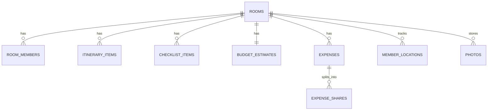

# OTW — Backend Master Plan
**Scope: Backend only (Spring Boot 21 + Supabase Postgres + Redis + Supabase Auth/Realtime)**

> **2026-09-29:** Group/barkada tier removed — see docs/OTW - WEB.pdf's flat Room-only tasking. Backend now has one authorization tier (Room), not two. Anonymous Supabase sessions are rejected; a registered account is required (overrides the PDF's no-login flow).

This guide takes the OTW Master Project Management Plan and narrows it to everything the backend team needs, from an empty repo to a production-ready API. Frontend/UI/branding work is intentionally out of scope here.

---

## 0. Backend Guiding Rules

1. Postgres (Supabase) is the source of truth. Redis is disposable — the API must degrade gracefully (slower, not broken) if Redis is down.
2. Every endpoint that touches a room must check **room membership + role**, even if the JWT is valid. Valid identity ≠ valid access.
3. Money math uses `BigDecimal` with a fixed scale (2 decimals) and `RoundingMode.HALF_UP` — never `double`/`float`.
4. No endpoint returns an unbounded collection — everything paginated.
5. Every mutation that other room members should see emits a realtime event. Realtime is a *broadcast of a change*, not a replacement for querying the DB.
6. Don't build microservices. One Spring Boot modular monolith, package-by-feature.

---

## 1. Backend Project Structure

```
otw-backend/
├── src/main/java/com/otw/
│   ├── OtwApplication.java
│   ├── config/              # SecurityConfig, RedisConfig, CacheConfig, CorsConfig, WebSocketConfig, RateLimitConfig
│   ├── common/               # BaseException, ApiResponse, ErrorCode, AuditFields, PageResponse
│   ├── security/
│   │   ├── jwt/               # Supabase JWT filter + JWK verification (+ NotAnonymousJwtValidator)
│   │   ├── authz/              # @RequireRoomRole annotation + aspect, access guard
│   ├── room/
│   │   ├── controller/
│   │   ├── dto/
│   │   ├── entity/
│   │   ├── repository/
│   │   └── service/
│   ├── rsvp/
│   │   ├── controller/
│   │   ├── dto/
│   │   ├── entity/
│   │   ├── repository/
│   │   └── service/
│   ├── itinerary/
│   │   ├── controller/
│   │   ├── dto/
│   │   ├── entity/
│   │   ├── repository/
│   │   └── service/
│   ├── checklist/
│   │   ├── controller/
│   │   ├── dto/
│   │   ├── entity/
│   │   ├── repository/
│   │   └── service/
│   ├── budget/
│   │   ├── controller/
│   │   ├── dto/
│   │   ├── entity/
│   │   ├── repository/
│   │   └── service/
│   ├── expense/
│   │   ├── controller/
│   │   ├── dto/
│   │   ├── entity/
│   │   ├── repository/
│   │   └── service/
│   ├── location/
│   │   ├── controller/
│   │   ├── dto/
│   │   ├── entity/
│   │   ├── repository/
│   │   └── service/
│   ├── photo/
│   │   ├── controller/
│   │   ├── dto/
│   │   ├── entity/
│   │   ├── repository/
│   │   └── service/
│   ├── realtime/                # RealtimeEventPublisher (Supabase Broadcast client) — cross-cutting, no controller
│   ├── cache/                   # CacheKeys, CacheEvictionService — cross-cutting, no controller
│   └── ratelimit/                # cross-cutting, no controller
├── src/main/resources/
│   ├── application.yml
│   ├── application-local.yml
│   ├── application-prod.yml
│   └── db/migration/            # Flyway: V1__init.sql, V2__..., etc.
└── src/test/java/com/otw/       # mirrors main packages
```

Every feature package (`room`, `rsvp`, `itinerary`, `checklist`, `budget`, `expense`, `location`, `photo`) follows the same five-folder shape:

- **`controller/`** — REST endpoints only. No business logic, no direct repository calls — delegates to `service/`.
- **`dto/`** — request/response objects (e.g. `CreateRoomRequest`, `RoomSummaryDto`). Controllers bind to these, never to entities directly (prevents mass assignment — §9).
- **`entity/`** — JPA entities mapped to the tables in §3 (e.g. `Room`, `RoomMember`).
- **`repository/`** — Spring Data JPA repositories, one per entity.
- **`service/`** — business logic, transaction boundaries (`@Transactional`), authorization-adjacent logic that isn't already covered by the `@RequireRoomRole` aspect, and where realtime events / cache evictions get triggered after a write.

`realtime/`, `cache/`, and `ratelimit/` stay cross-cutting (no five-folder split) since they're shared infrastructure every feature calls into, not a feature with its own endpoints.

---

## 2. Backend Roadmap (mapped to WBS in the master doc)

| Phase | Backend Deliverable | Maps to |
|---|---|---|
| Phase 3 — Technical Planning | ERD, API contract, auth model, cache/realtime architecture (this doc) | WBS 4–9 |
| Phase 4 — Foundation | Repo, Spring Boot skeleton, Flyway baseline, Supabase project, Redis, CI | WBS 4 |
| Phase 5 — Core MVP | Room → Members → RSVP → Itinerary → Checklist → Budget → Expenses | Sprints 2–4 |
| Phase 6 — Realtime + Performance | Realtime publisher, Redis caching, rate limiting, indexing | Sprint 5 |
| Phase 7 — Fun Layer | Location sharing, wheel/decision endpoints (thin, stateless) | Sprint 5 |
| Phase 8 — QA + Security | Test suite, threat mitigations, load test | Sprint 6 |

---

## 3. Database Design

### 3.1 Core tables

Flat model: every **Room** (one-off gala/trip) is standalone. There is no persistent group/barkada tier — `room_members` is the only membership table (Group/barkada tier removed 2026-09-29, see docs/OTW - WEB.pdf's flat Room-only model).

```sql
-- rooms — one gala/trip, always standalone
rooms (
  id UUID PK DEFAULT gen_random_uuid(),
  room_code VARCHAR(8) UNIQUE NOT NULL,   -- short, human-shareable, indexed
  title VARCHAR(120) NOT NULL,
  schedule_at TIMESTAMPTZ,
  meeting_lat DOUBLE PRECISION,
  meeting_lng DOUBLE PRECISION,
  meeting_label VARCHAR(255),
  host_user_id UUID NOT NULL,
  status VARCHAR(20) NOT NULL DEFAULT 'ACTIVE', -- ACTIVE, ARCHIVED
  created_at TIMESTAMPTZ NOT NULL DEFAULT now(),
  updated_at TIMESTAMPTZ NOT NULL DEFAULT now()
);

-- room_members
room_members (
  id UUID PK DEFAULT gen_random_uuid(),
  room_id UUID NOT NULL REFERENCES rooms(id) ON DELETE CASCADE,
  user_id UUID NOT NULL,               -- Supabase auth.users.id
  nickname VARCHAR(60) NOT NULL,
  role VARCHAR(20) NOT NULL DEFAULT 'MEMBER',  -- HOST, MEMBER
  rsvp_status VARCHAR(20) NOT NULL DEFAULT 'PENDING', -- GOING, MAYBE, NOT_GOING, PENDING
  joined_at TIMESTAMPTZ NOT NULL DEFAULT now(),
  left_at TIMESTAMPTZ,
  UNIQUE (room_id, user_id)
);
-- Partial unique index (added V5): nickname unique per room, case-insensitive, active members only
-- CREATE UNIQUE INDEX idx_room_members_room_nickname_active ON room_members (room_id, LOWER(nickname)) WHERE left_at IS NULL;

-- itinerary_items
itinerary_items (
  id UUID PK DEFAULT gen_random_uuid(),
  room_id UUID NOT NULL REFERENCES rooms(id) ON DELETE CASCADE,
  title VARCHAR(150) NOT NULL,
  notes TEXT,
  starts_at TIMESTAMPTZ,
  position INT NOT NULL,               -- for manual ordering
  created_by UUID NOT NULL,
  completed BOOLEAN NOT NULL DEFAULT false,
  version INT NOT NULL DEFAULT 0,      -- optimistic locking
  created_at TIMESTAMPTZ NOT NULL DEFAULT now(),
  updated_at TIMESTAMPTZ NOT NULL DEFAULT now()
);

-- checklist_items
checklist_items (
  id UUID PK DEFAULT gen_random_uuid(),
  room_id UUID NOT NULL REFERENCES rooms(id) ON DELETE CASCADE,
  label VARCHAR(150) NOT NULL,
  assigned_to UUID,                    -- nullable → unassigned
  is_done BOOLEAN NOT NULL DEFAULT false,
  done_by UUID,
  done_at TIMESTAMPTZ,
  version INT NOT NULL DEFAULT 0,
  created_at TIMESTAMPTZ NOT NULL DEFAULT now()
);

-- budget_estimates
budget_estimates (
  room_id UUID PRIMARY KEY REFERENCES rooms(id) ON DELETE CASCADE,
  estimated_amount NUMERIC(12,2) NOT NULL DEFAULT 0,
  currency VARCHAR(3) NOT NULL DEFAULT 'PHP',
  updated_by UUID,
  updated_at TIMESTAMPTZ NOT NULL DEFAULT now()
);

-- expenses
expenses (
  id UUID PK DEFAULT gen_random_uuid(),
  room_id UUID NOT NULL REFERENCES rooms(id) ON DELETE CASCADE,
  description VARCHAR(150) NOT NULL,
  amount NUMERIC(12,2) NOT NULL CHECK (amount > 0),
  paid_by UUID NOT NULL,               -- room_members.user_id
  created_at TIMESTAMPTZ NOT NULL DEFAULT now()
);

-- expense_shares
expense_shares (
  id UUID PK DEFAULT gen_random_uuid(),
  expense_id UUID NOT NULL REFERENCES expenses(id) ON DELETE CASCADE,
  user_id UUID NOT NULL,
  share_amount NUMERIC(12,2) NOT NULL CHECK (share_amount >= 0),
  UNIQUE (expense_id, user_id)
);

-- locations (live/pin sharing — ephemeral, see §7)
member_locations (
  room_id UUID NOT NULL REFERENCES rooms(id) ON DELETE CASCADE,
  user_id UUID NOT NULL,
  lat DOUBLE PRECISION NOT NULL,
  lng DOUBLE PRECISION NOT NULL,
  share_mode VARCHAR(10) NOT NULL,     -- PIN, LIVE
  expires_at TIMESTAMPTZ NOT NULL,     -- LIVE shares auto-expire
  updated_at TIMESTAMPTZ NOT NULL DEFAULT now(),
  PRIMARY KEY (room_id, user_id)
);

-- photos (metadata only; binary lives in Google Drive)
photos (
  id UUID PK DEFAULT gen_random_uuid(),
  room_id UUID NOT NULL REFERENCES rooms(id) ON DELETE CASCADE,
  drive_file_id VARCHAR(200) NOT NULL,
  uploaded_by UUID NOT NULL,
  status VARCHAR(20) NOT NULL DEFAULT 'PENDING', -- PENDING, READY, FAILED
  created_at TIMESTAMPTZ NOT NULL DEFAULT now()
);
```

### 3.2 Indexes (minimum set)
- `rooms(room_code)` — unique, used on every "join" call
- `room_members(room_id, user_id)` — unique composite, used on every authorization check
- `room_members(room_id, LOWER(nickname)) WHERE left_at IS NULL` — unique partial index, enforces per-room nickname uniqueness among active members
- `room_members(user_id)` — "my rooms" queries
- `itinerary_items(room_id, position)`
- `checklist_items(room_id, is_done)`
- `expenses(room_id)`, `expense_shares(expense_id)`
- `member_locations(room_id)` with a background job / `expires_at` cleanup

### 3.3 Concurrency fields
- `version` (optimistic locking via `@Version` in JPA) on itinerary and checklist items — this is what answers "two people edit the same item at once": last-write loses with a `409 CONFLICT`, client refetches.
- Expense creation has no shared mutable row to race on (each expense is its own insert) — no locking needed there, only on the *settlement calculation*, which should always be computed on read, never stored as a mutable running total.

### 3.4 Flyway
Since Flyway is already the chosen tool: keep migrations additive and reversible in spirit (no `DROP COLUMN` in early sprints), one feature per migration file (`V3__add_checklist_items.sql`), and never edit a migration that has already run in a shared environment — add a new one instead.

### 3.5 ERD (Mermaid)


---

## 4. API Contract (`/api/v1`)

Conventions: JSON, `Authorization: Bearer <supabase_jwt>` on every call, including `POST /rooms/join` — every non-public endpoint requires a registered account (see §5.1), cursor-based pagination (`?cursor=...&limit=20`), errors as `{ "code": "ROOM_NOT_FOUND", "message": "..." }`.

| Method | Path | Purpose | Role |
|---|---|---|---|
| POST | `/rooms` | Create standalone room | Authenticated |
| GET | `/rooms/{roomId}` | Room overview | Member |
| POST | `/rooms/join` | Join by room code | Authenticated |
| GET | `/rooms/{roomId}/members` | Member list | Member |
| DELETE | `/rooms/{roomId}/members/{userId}` | Remove member | Host |
| PATCH | `/rooms/{roomId}/members/me/rsvp` | Update own RSVP | Member |
| GET | `/rooms/{roomId}/itinerary` | List items | Member |
| POST | `/rooms/{roomId}/itinerary` | Add item | Member |
| PATCH | `/rooms/{roomId}/itinerary/{itemId}` | Edit item (needs `version`) | Member (owner or host) |
| DELETE | `/rooms/{roomId}/itinerary/{itemId}` | Remove item | Member (owner or host) |
| GET | `/rooms/{roomId}/checklist` | List items | Member |
| POST | `/rooms/{roomId}/checklist` | Add item | Member |
| PATCH | `/rooms/{roomId}/checklist/{itemId}` | Toggle/assign (needs `version`) | Member |
| GET/PUT | `/rooms/{roomId}/budget` | Get/set estimate | Member / Host |
| GET | `/rooms/{roomId}/expenses` | List, paginated | Member |
| POST | `/rooms/{roomId}/expenses` | Add expense + shares | Member |
| GET | `/rooms/{roomId}/expenses/settlement` | Computed "who owes who" | Member |
| PUT | `/rooms/{roomId}/location` | Share pin or start live share | Member (opt-in) |
| DELETE | `/rooms/{roomId}/location` | Stop sharing | Member |
| GET | `/rooms/{roomId}/locations` | Current shared locations | Member |
| POST | `/rooms/{roomId}/photos` | Register uploaded photo metadata | Member |

Every write endpoint: Bean Validation on the request DTO, ownership/role check via the `@RequireRoomRole` aspect (see §5.3), and — where relevant — emits a realtime event (§8) and evicts a cache key (§6).

Error codes added since the original contract: `409 DUPLICATE_NICKNAME` on `POST /rooms/join` (nickname already taken by an active member of that room) and `401 ACCOUNT_REQUIRED` on any endpoint when the token belongs to a rejected anonymous session (distinct from the generic `401 UNAUTHENTICATED` — see §5.1).

---

## 5. Authentication & Authorization

### 5.1 Authentication (who are you)
- Supabase Auth issues JWTs. Although Supabase supports anonymous auth, this backend rejects those sessions — see the rejection rule immediately below.
- Spring Boot does **not** re-implement login, signup, or token refresh — the frontend talks to Supabase Auth directly and just attaches the resulting token as `Authorization: Bearer <token>`. The backend's only job is to **verify** that token on every request.
- Reject any token whose `aud`/`iss` doesn't match your Supabase project.
- **Anonymous Supabase sessions are rejected (2026-09-29, overrides the PDF's no-login flow).** A `NotAnonymousJwtValidator` in the `JwtDecoder`'s validator chain fails any token with `is_anonymous: true` or a blank `email` claim, fail-closed. The auth entry point maps that specific rejection to `401 {"code":"ACCOUNT_REQUIRED"}` (distinct from the generic `401 UNAUTHENTICATED`) so the frontend can route the user to sign-in. Every non-public endpoint requires a registered account (email/OTP or password via Supabase Auth).

#### 5.1.1 Implementation — verifying Supabase JWTs in Spring Boot

Use Spring Security's built-in **OAuth2 Resource Server** support rather than hand-rolling JWKS fetching/caching — it already handles key rotation, caching, and signature verification correctly.

**Dependencies (`build.gradle`):**
```groovy
implementation 'org.springframework.boot:spring-boot-starter-oauth2-resource-server'
implementation 'org.springframework.boot:spring-boot-starter-security'
```

**`application.yml`:**
```yaml
supabase:
  project-url: ${SUPABASE_URL}          # e.g. https://xxxx.supabase.co
  jwt-audience: ${SUPABASE_JWT_AUD:authenticated}

spring:
  security:
    oauth2:
      resourceserver:
        jwt:
          jwk-set-uri: ${SUPABASE_URL}/auth/v1/.well-known/jwks.json
          issuer-uri: ${SUPABASE_URL}/auth/v1
```
`jwk-set-uri` is what gives you automatic key fetch + cache + rotation for free — Spring re-fetches keys on a cache-miss (e.g. unknown `kid` after Supabase rotates keys) rather than you writing that logic yourself.

**`SecurityConfig.java`:**
```java
@Configuration
@EnableWebSecurity
@EnableMethodSecurity
public class SecurityConfig {

    @Value("${supabase.jwt-audience}")
    private String expectedAudience;

    @Bean
    public SecurityFilterChain filterChain(HttpSecurity http) throws Exception {
        http
            .csrf(AbstractHttpConfigurer::disable)   // stateless bearer-token API
            .sessionManagement(sm -> sm.sessionCreationPolicy(SessionCreationPolicy.STATELESS))
            .authorizeHttpRequests(auth -> auth
                .requestMatchers("/actuator/health").permitAll()
                .anyRequest().authenticated()
            )
            .oauth2ResourceServer(oauth2 -> oauth2
                .jwt(jwt -> jwt.jwtAuthenticationConverter(supabaseJwtConverter()))
            )
            .exceptionHandling(ex -> ex
                .authenticationEntryPoint((req, res, e) -> {
                    res.setStatus(HttpServletResponse.SC_UNAUTHORIZED);
                    res.setContentType("application/json");
                    res.getWriter().write("{\"code\":\"UNAUTHENTICATED\",\"message\":\"Invalid or missing token\"}");
                })
                .accessDeniedHandler((req, res, e) -> {
                    res.setStatus(HttpServletResponse.SC_FORBIDDEN);
                    res.setContentType("application/json");
                    res.getWriter().write("{\"code\":\"FORBIDDEN\",\"message\":\"Not allowed\"}");
                })
            );
        return http.build();
    }

    // Explicit audience + issuer validation on top of the default signature/expiry checks
    @Bean
    public JwtDecoder jwtDecoder(@Value("${spring.security.oauth2.resourceserver.jwt.jwk-set-uri}") String jwkSetUri,
                                  @Value("${spring.security.oauth2.resourceserver.jwt.issuer-uri}") String issuerUri) {
        NimbusJwtDecoder decoder = NimbusJwtDecoder.withJwkSetUri(jwkSetUri).build();

        OAuth2TokenValidator<Jwt> withIssuer = JwtValidators.createDefaultWithIssuer(issuerUri); // exp, iat, issuer
        OAuth2TokenValidator<Jwt> withAudience = jwt ->
            jwt.getAudience().contains(expectedAudience)
                ? OAuth2TokenValidatorResult.success()
                : OAuth2TokenValidatorResult.failure(new OAuth2Error("invalid_audience", "aud mismatch", null));

        decoder.setJwtValidator(new DelegatingOAuth2TokenValidator<>(withIssuer, withAudience));
        return decoder;
    }

    // Maps the Supabase JWT's "sub" claim (and role claim, if you add one) into Spring's Authentication
    @Bean
    public Converter<Jwt, AbstractAuthenticationToken> supabaseJwtConverter() {
        return jwt -> {
            String userId = jwt.getSubject(); // Supabase auth.users.id
            List<GrantedAuthority> authorities = List.of(new SimpleGrantedAuthority("ROLE_USER"));
            return new JwtAuthenticationToken(jwt, authorities, userId);
        };
    }
}
```

**Reading the current user in a controller/service** — avoid pulling `SecurityContextHolder` everywhere; wrap it once:
```java
@Component
public class CurrentUserProvider {
    public UUID getUserId() {
        Authentication auth = SecurityContextHolder.getContext().getAuthentication();
        if (auth == null || !auth.isAuthenticated()) {
            throw new UnauthenticatedException();
        }
        return UUID.fromString(auth.getName()); // "name" = the sub we set above
    }
}
```

**What this gives you automatically:** signature verification against Supabase's live JWKS, expiry (`exp`) and issued-at checks, key rotation handling, and now explicit `aud` checking on top. **What it does NOT do:** room membership/role checks — that's still the separate `@RequireRoomRole` authorization layer in §5.2, which runs *after* this filter, using the `userId` this filter puts in the security context.

### 5.2 Authorization (are you allowed here) — one tier

There is a single membership check: room membership. There is no group tier to conflate it with.

Layered checks, cheapest first, for a **room**-scoped endpoint:
1. **JWT valid?** → filter, rejects before hitting a controller.
2. **Room exists?** → 404 if not (don't leak "exists but you can't see it" vs "doesn't exist" — same 404 for both to avoid room-code enumeration hints).
3. **Is this user a member of this room?** → `room_members` lookup, cached (see §6). 403 if not.
4. **Does this action require HOST?** → role check.

Implement as a method-level guard, not scattered in controllers:

```java
@RequireRoomRole(RoomRole.MEMBER)
@PatchMapping("/rooms/{roomId}/checklist/{itemId}")
public ChecklistItemDto toggle(@PathVariable UUID roomId, ...) { ... }
```
One AOP aspect (`RoomAccessGuard`) reads the `roomId` path variable, looks up membership cache-first, and throws `403` before the method body runs.

This layered guard is the single most important control against "guessing/manipulating URLs" (Objective O5) — never trust a `roomId` in the path or body without the matching check, on every endpoint, no exceptions.

### 5.3 Role matrix (starting point — refine per feature)

**Room level**

| Action | HOST | MEMBER | Unauthenticated |
|---|---|---|---|
| Create room | ✅ (becomes host) | ✅ | ❌ |
| Join room | ✅ | ✅ | ❌ |
| Edit room details | ✅ | ❌ | ❌ |
| Remove member | ✅ | ❌ | ❌ |
| RSVP (own) | ✅ | ✅ | ❌ |
| Itinerary/checklist add | ✅ | ✅ | ❌ |
| Itinerary/checklist edit/delete | ✅ | owner only | ❌ |
| Add expense | ✅ | ✅ | ❌ |
| Delete expense | ✅ | payer only | ❌ |
| Share location | ✅ | ✅ (opt-in) | ❌ |
| View another room's data | ❌ | ❌ | ❌ |

### 5.4 Row-Level Security as a second layer
Even though Spring Boot enforces authorization, if the mobile team ever queries Supabase directly (e.g. Realtime subscription payloads, or a future direct-to-Supabase read), **RLS policies on every table must independently enforce room membership**. Defense in depth: don't rely on the API being the only door.

---

## 6. Caching Strategy (Redis)

| Data | Cache? | Key | TTL | Invalidate on |
|---|---|---|---|---|
| Room membership check | Yes | `room:{roomId}:member:{userId}` | 5 min | member added/removed |
| Room overview | Yes | `room:{roomId}:overview` | 60 s | any room-level edit |
| Itinerary list | Yes | `room:{roomId}:itinerary` | 30 s | any itinerary write |
| Checklist list | Yes | `room:{roomId}:checklist` | 30 s | any checklist write |
| Budget/settlement summary | Yes | `room:{roomId}:settlement` | 30 s | any expense write |
| Live location | Redis only, no Postgres cache-through | `room:{roomId}:locations` (Redis Hash or GEO set) | tied to `expires_at` | on update/stop |
| Auth/JWT/JWKS | Yes (in-memory or Redis) | `jwks:{kid}` | per JWKS `max-age` header | key rotation |

Rules:
- **Cache-aside**, not write-through: write to Postgres first, then evict (not update) the cache key. Never let a cache write race ahead of the DB commit.
- **Fallback on Redis failure**: wrap cache reads in try/catch → on any Redis exception, fall through to Postgres and log a warning, never throw 500 because Redis is down. This directly satisfies Risk Register item "Redis outage."
- Membership cache must be evicted the instant a member is removed — a stale "yes you're a member" cache entry is a security bug, not just a performance one. Prefer a short TTL (5 min) plus explicit eviction rather than TTL alone.

---

## 7. Location Sharing (Pin + Live) — Backend Design

Two distinct modes, both opt-in per user, per room:

**Pin share**: one-shot coordinate, no expiry logic needed beyond "until replaced or removed." Store in `member_locations` with `share_mode = PIN`.

**Live share** (Messenger-style): periodic coordinate updates while active.
- Client posts an update every N seconds (start at 10–15s; tune after load testing) to `PUT /rooms/{roomId}/location`.
- Store the latest point in Redis (fast, ephemeral) keyed by `room:{roomId}:locations` — a Redis Hash of `userId → {lat,lng,updatedAt}`, or Redis GEO if you want proximity queries later ("who's closest to the meeting point").
- Persist to Postgres `member_locations` only for the *current* row (upsert), not a full history table — OTW doesn't need location history, just "where is everyone now."
- `expires_at` = now + short window (e.g. 2 minutes). A live share that stops sending updates auto-expires — the client doesn't have to explicitly "stop," it just goes stale. A scheduled job (or Redis key TTL) sweeps expired rows every minute.
- Broadcast `location.updated` on a private room channel on every update (§8) so other clients update the map without polling.

**Security specific to this feature**:
- GPS permission is a client concern, but the backend must never leak a user's last known location to a non-member — same `@RequireRoomRole` guard as everything else.
- Add a hard rate limit on the location-update endpoint (e.g. max 1 write per 3–5 seconds per user) — this is a realistic abuse/cost vector (battery-draining tight client loops, or a malicious client hammering the endpoint), not just theoretical.
- Explicit "stop sharing" must actually delete the Redis key and the Postgres row, not just mark a flag — a disabled-but-still-queryable location is a privacy leak.

---

## 8. Realtime

Approach: backend publishes events to **Supabase Realtime Broadcast** on **private, room-scoped channels** (`room:{roomId}`), authorized against room membership — Broadcast is the currently recommended pattern over raw Postgres Changes when access control matters, since Broadcast channels can be gated by your own authorization check rather than exposing raw table changes.

Event catalog (subset most relevant to backend implementation):

| Event | Trigger | Payload | Who receives |
|---|---|---|---|
| `member.joined` / `member.left` | membership row insert/soft-delete | `{userId, nickname}` | room members |
| `member.rsvp.changed` | RSVP patch | `{userId, status}` | room members |
| `itinerary.created/updated/completed` | itinerary write | full item DTO | room members |
| `checklist.updated` | checklist write | full item DTO | room members |
| `expense.created` | expense write | expense DTO (settlement recomputed client-side or via follow-up fetch) | room members |
| `location.updated` | location write | `{userId, lat, lng, mode}` | room members who opted into seeing locations |

Implementation notes:
- Centralize publishing in a single `RealtimeEventPublisher` service so every feature module calls one thing (`publisher.publish(roomId, "itinerary.updated", dto)`) instead of each module talking to Supabase directly.
- Publish **after** the DB transaction commits (e.g. via `TransactionSynchronizationManager.registerSynchronization` or `@TransactionalEventListener(phase = AFTER_COMMIT)`), so clients never receive an event for a write that then rolled back.
- Client reconnection: on reconnect, the client should refetch the relevant list (itinerary, checklist, etc.) rather than trusting it caught every event while disconnected — realtime is a UX accelerant, the paginated GET is still the source of truth.
- Duplicate events are fine if the client applies them idempotently by ID + `updated_at`/`version` — don't over-engineer exactly-once delivery on the backend.

---

## 9. Security Plan (backend-specific additions)

Beyond the master doc's threat list, concrete backend controls:

| Threat | Backend Mitigation |
|---|---|
| Room-code guessing | Room codes generated with enough entropy (e.g. 8 chars, mixed alphanumeric, excluding ambiguous characters) + rate-limit `POST /rooms/join` per IP/user (e.g. 5/min) |
| Broken object-level authorization (OWASP API1) | `@RequireRoomRole` aspect on **every** room-scoped endpoint, no exceptions; covered by an automated test that iterates all endpoints |
| Broken function-level authorization (OWASP API5) | Host-only actions checked server-side, never trust a `role` field sent by the client |
| Mass assignment | DTOs are explicit request objects, never bind directly to JPA entities |
| Unrestricted resource consumption (OWASP API4) | Pagination everywhere, request size limits, rate limiting (e.g. Bucket4j) on write endpoints and especially `location` updates |
| JWT misuse (expired/forged/wrong audience) | Verify signature, `exp`, `aud`, `iss` on every request; short-lived tokens, refresh handled by Supabase client SDK |
| Malicious file "uploads" | Backend only stores a Drive file reference, never accepts raw binary — `GoogleDriveFileValidator` (`photo` package) calls Drive's read-only `files.get` to confirm the submitted ID is a real, non-trashed image in the configured shared folder before marking `READY`; fails closed (rejects) if Drive isn't configured or the lookup fails. Configured via `GOOGLE_DRIVE_CREDENTIALS_JSON_BASE64` / `GOOGLE_DRIVE_PHOTOS_FOLDER_ID` env vars. |
| CSRF | Not applicable in the classic sense for a stateless Bearer-token API, but still restrict CORS to known frontend origins only |
| Cache data leakage | Every cache key is scoped by `roomId` (and `userId` for membership checks) — never a global "all rooms" cache entry |
| Location privacy | Explicit opt-in, short TTL, hard delete on stop-share, rate limiting (see §7) |
| Secrets in repo | `.env`/`application-local.yml` gitignored; production secrets via Render environment variables, never committed |

Recommended additions not explicitly in the master doc but worth building in from the start:
- **Security headers** via a simple filter: `X-Content-Type-Options: nosniff`, `X-Frame-Options: DENY`, `Referrer-Policy: no-referrer`.
- **Structured audit logging** for host-only actions (member removal, room deletion) — just a log line with `who/what/when`, no separate audit table needed for a student project.
- **Global exception handler** (`@ControllerAdvice`) that never leaks stack traces or SQL errors to the client — always a stable `{code, message}` shape.

---

## 10. Testing Strategy (backend)

| Level | Tooling | Focus |
|---|---|---|
| Unit | JUnit 5 + Mockito | Settlement math, validation logic, mapping |
| Integration | `@SpringBootTest` + Testcontainers (Postgres) | Repository queries, Flyway migrations run cleanly |
| API | RestAssured / MockMvc | Auth rejection, role checks, pagination, error shapes |
| Concurrency | JUnit + `ExecutorService` simulating parallel requests | Optimistic-lock conflict on itinerary/checklist edits behaves correctly |
| Security | Manual + automated endpoint sweep | Every room-scoped endpoint rejects a non-member's valid JWT |
| Load | k6 or Gatling | 10/25/50/100/200 concurrent users; measure p95/p99, error rate, Redis hit rate, connection pool saturation |
| Cache-failure | Manual: stop Redis container mid-test | API keeps serving from Postgres, no 500s |

Suggested acceptance targets to start from (refine after real load tests): P95 < 500 ms, P99 < 1.5 s, error rate < 1%.

---

## 11. Deployment & Environment

- **Environments**: local (docker-compose: Postgres via Supabase CLI or plain Postgres, Redis), staging, production (Render for Spring Boot, Supabase managed for DB/Auth/Realtime).
- **Env vars** (never committed): `SUPABASE_URL`, `SUPABASE_JWT_AUD`, `SUPABASE_JWKS_URL`, `SPRING_DATASOURCE_URL/USERNAME/PASSWORD`, `REDIS_URL`, `GOOGLE_DRIVE_*` credentials.
- **CORS**: allow-list only the deployed Vercel frontend URL(s) + localhost for dev.
- **CI**: on every PR — run unit + integration tests, run Flyway migrations against a throwaway Testcontainers DB, fail the build on any migration error.
- **Pre-release backend checklist**: Flyway migrations applied cleanly on a fresh DB, secrets not in repo, CORS locked down, rate limits enabled, Redis fallback verified, load test results documented, `/actuator/health` (or similar) not publicly exposing sensitive details.

---

## 12. Backend-Only Sprint Breakdown

| Sprint | Backend Deliverables | Exit Gate |
|---|---|---|
| 0 — Discovery | This doc reviewed/approved, ERD + API contract frozen | Team can answer "what does the backend expose?" |
| 1 — Foundation | Repo, Spring Boot skeleton, Flyway V1 (rooms/members), JWT filter, CI green | A protected endpoint correctly rejects an invalid token |
| 2 — Room + Members | Create/join room, membership, RSVP, `@RequireRoomRole` aspect | Two users can join the same room, and a third person can't see it |
| 3 — Collaboration | Itinerary, checklist (with optimistic locking), realtime publisher wired in | Two clients see each other's itinerary/checklist changes live |
| 4 — Money | Budget, expenses, expense shares, settlement calculation | Settlement math verified correct on test scenarios (incl. uneven splits) |
| 5 — Performance + Fun | Redis caching, rate limiting, location sharing (pin + live) | Cache-failure test passes; live location updates broadcast correctly |
| 6 — Hardening | Security sweep, load test, docs finalized | Backend release checklist fully checked |

---

## 13. Open Items to Confirm With the Team (don't assume these)

- Exact room-code format/length and collision-retry strategy.
- Whether expense settlement should support partial payments/"marked as settled" state, or stay a pure calculated view (recommended for MVP: pure calculated view, no settlement persistence).
- Live-location update interval and auto-expiry window (defaults suggested above, tune after testing).

**Resolved 2026-09-29:** Anonymous Supabase auth is not acceptable — a registered account (email/OTP or password) is required for every non-public endpoint. See §5.1.